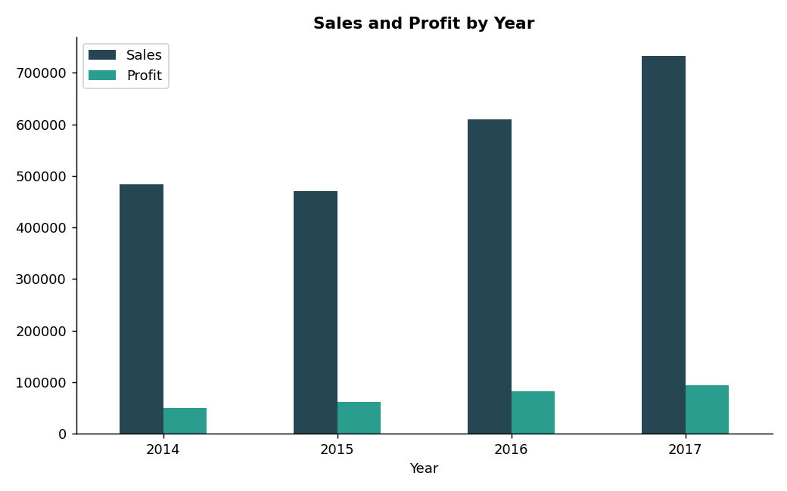
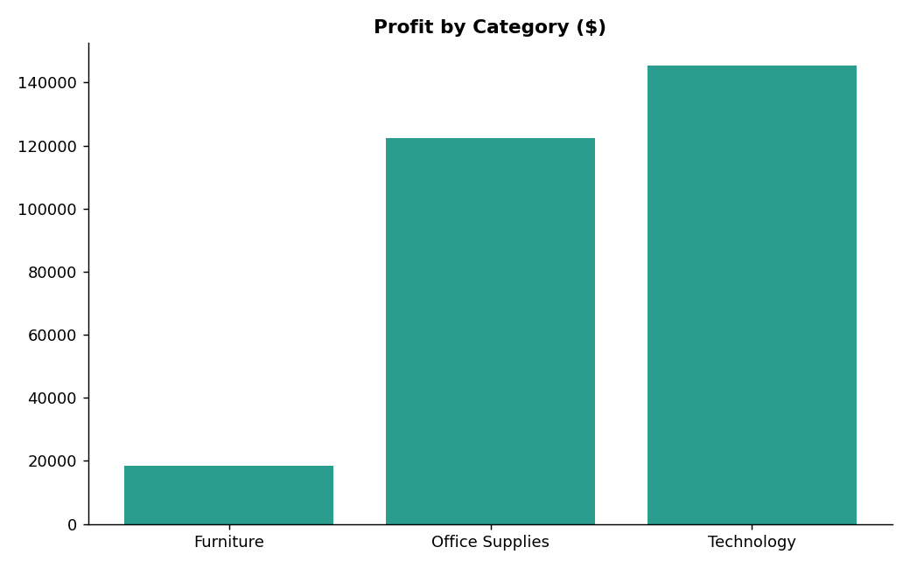
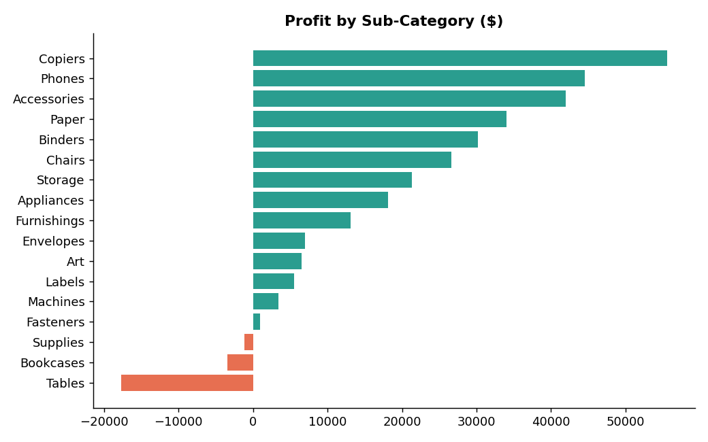
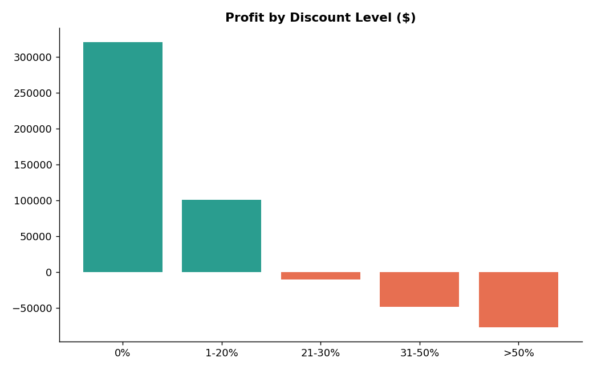
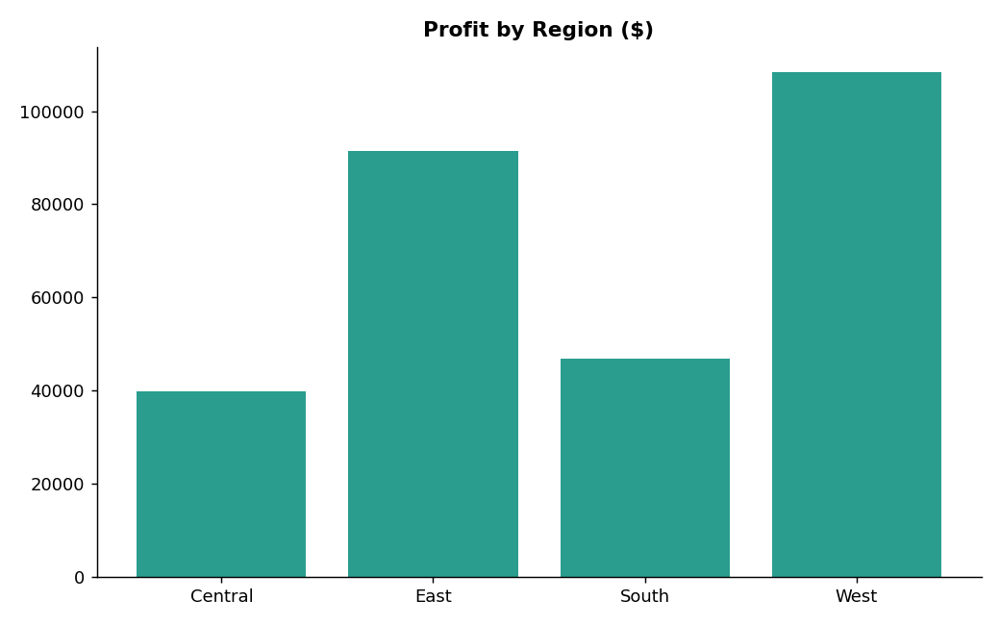
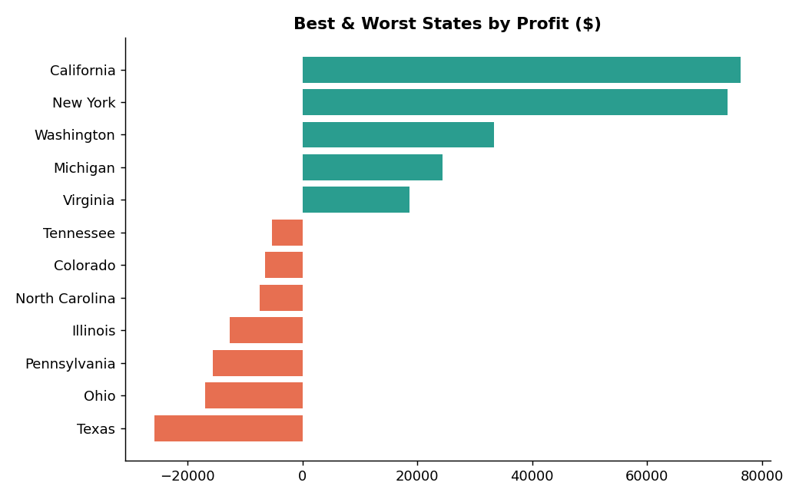

# 🛒 USA Superstore Sales Analysis

**Question:** Where does this store make money, and where does it quietly lose it?

**Data:** 9,994 order lines · 5,009 orders · 793 customers · Jan 2014 – Dec 2017 (no missing values, no duplicates)
**Tools:** Python (pandas, matplotlib) · Chart.js dashboard

## 📌 Key numbers
| Sales | Profit | Margin |
|---|---|---|
| $2.30M | $286K | 12.5% |

## 📖 The story

### 1. The business is growing
Sales rose from **$484K (2014) to $733K (2017)**, about +51%. Profit grew from $49.5K to $93.4K.



### 2. But one category barely earns anything
Technology (17.4% margin) and Office Supplies (17.0%) are strong. **Furniture sells $742K but only makes $18K profit (2.5% margin).**



### 3. Three sub-categories lose money
**Tables (-$17.7K), Bookcases (-$3.5K) and Supplies (-$1.2K)** are in the red. Copiers, Phones and Accessories are the stars.



### 4. The culprit: heavy discounts
Orders with **0-20% discount are very profitable**. Above 20%, every band loses money. Together, discounts over 20% (14% of order lines) lose about **$135K**.



### 5. The Central region discounts the most
Average discount: **Central 24%**, East 15%, South 15%, **West 11%**. Result: Central has the lowest margin (7.9%) while West has the highest (14.9%).



### 6. A few states drag profit down
**Texas (-$25.7K), Ohio (-$17.0K), Pennsylvania (-$15.6K) and Illinois (-$12.6K)** lose money. California, New York and Washington lead.



## ✅ Recommendations
1. **Cap discounts at 20%.** Biggest and simplest win.
2. **Review Furniture pricing**, especially Tables and Bookcases.
3. **Investigate Central region and loss-making states** (Texas, Ohio, Pennsylvania, Illinois).
4. **Double down on Technology and Office Supplies**, which carry the profit.

## 📊 Interactive dashboard
Open `dashboard.html` in any browser (needs internet for the Chart.js library). Filter by year, region and category.

## 📁 Repository
```
├── data/          Superstore Excel file
├── images/        Charts used in this report
├── analysis.py    Generates the charts
├── build_dashboard.py + dashboard_template.html → dashboard.html
└── README.md
```
Run: `pip install pandas matplotlib openpyxl && python analysis.py`

*Analysis by Favour Daniel*
